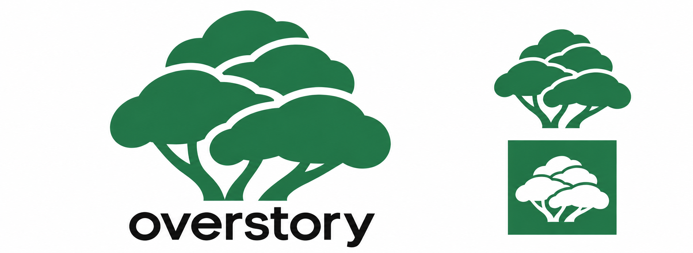

# Overstory logo draft

The layered-crowns concept connects life in a forest canopy with Overstory's
stacked overlays and dialogs. Overlapping green crowns emphasize the layers;
short branches keep the tree recognizable.

These are draft raster assets for design feedback, generated with OpenAI's
built-in image generation tool. The concept sheet is the visual reference.
The standalone exports were generated from that reference and may differ
slightly in geometry. They are not final vector masters.

## Assets

| File | Purpose | Background | Dimensions |
| --- | --- | --- | --- |
| [overstory-concept.png](overstory-concept.png) | Concept sheet, including white-on-green preview | White | 2072 × 759 |
| [overstory-logo.png](overstory-logo.png) | Green canopy above the black wordmark | Transparent | 1463 × 1075 |
| [overstory-mark.png](overstory-mark.png) | Standalone green canopy | Transparent | 1254 × 1254 |
| [overstory-emoji.png](overstory-emoji.png) | Slack custom emoji, resized from the standalone mark | Transparent | 128 × 128 |

The intended forest green is `#237A4B`; generated raster pixels have slight
color variation. Use the black-wordmark logo on light backgrounds.

To add the emoji in Slack, open the emoji picker, choose **Add Emoji**, upload
`overstory-emoji.png`, and name it `overstory` to use it as `:overstory:`.
The transparent square PNG is under Slack's recommended 128 KB size.
See [Slack's custom emoji instructions](https://slack.com/help/articles/206870177-Add-custom-emoji-and-aliases-to-your-workspace).

Before finalizing, review the canopy layering, wordmark, and green with Keith.
After the direction is approved, create consistent vector masters and check
legibility at small icon sizes.
